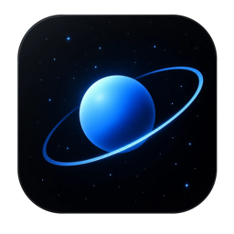

# Órbita

**Seu assistente de IA no computador.** Converse com GPT, Claude, Gemini, DeepSeek e centenas de outros modelos num app só, com a sua própria chave, e comece grátis com os modelos gratuitos.

### ⬇️ Baixar

| | |
|---|---|
| 🪟 **Windows 10 e 11** | [**Baixar para Windows**](https://github.com/lojapromax00-arch/orbita-ai-download/releases/latest/download/Orbita-AI-Windows-Setup.exe) |
| 🍎 **Mac com chip Apple (M1, M2, M3, M4…)** | [**Baixar para Mac (Apple)**](https://github.com/lojapromax00-arch/orbita-ai-download/releases/latest/download/Orbita-AI-Mac-AppleSilicon.dmg) |
| 🍎 **Mac com Intel** | [**Baixar para Mac (Intel)**](https://github.com/lojapromax00-arch/orbita-ai-download/releases/latest/download/Orbita-AI-Mac-Intel.dmg) |

Não sabe qual é o seu Mac? Menu  → Sobre Este Mac: se aparecer “Chip Apple M…”, é Apple; se aparecer “Intel”, é Intel.

---

## Instalar no Windows

1. Abra o arquivo baixado (`Orbita-AI-Windows-Setup.exe`).
2. O Windows pode mostrar **“O Windows protegeu o computador”**. Isso aparece com todo app que não pagou o certificado da Microsoft; não é vírus.
   - Clique em **Mais informações**.
   - Clique em **Executar assim mesmo**.
3. A instalação termina sozinha e o Órbita abre.

## Instalar no Mac

1. Abra o arquivo `.dmg` baixado e arraste o **Órbita** para a pasta **Aplicativos**.
2. **Na primeira vez**, abra assim: vá em **Aplicativos**, clique no Órbita com o **botão direito** (ou Control + clique) e escolha **Abrir**. Na janela que aparecer, clique em **Abrir** de novo.
   - Se o Mac disser que “não pode ser aberto”: abra **Ajustes do Sistema → Privacidade e Segurança**, role até o fim e clique em **Abrir Mesmo Assim** ao lado do Órbita.
3. Pronto: das próximas vezes ele abre normal, e as atualizações chegam sozinhas.

## Começar a usar (1 minuto)

1. Na primeira tela, escolha **Começar grátis**.
2. Clique em **Abrir site**, entre no OpenRouter com a sua conta do Google (não pede cartão) e clique em **Create key**.
3. Copie a chave, cole no Órbita e clique em **Conectar**. Já fica um modelo gratuito escolhido.

> Os modelos grátis têm um limite de uso por dia. Para usar mais, ou modelos como GPT e Claude, é só colocar créditos no OpenRouter (você paga só o que usar).

## Dicas

- **⌘K** (Mac) ou **Ctrl+K** (Windows): acha qualquer conversa, ação ou ajuste.
- **Pasta**: abra uma pasta na caixa de mensagem para a IA ler e editar seus arquivos.
- **Voz**: converse falando, sem digitar.
- **?**: mostra todos os atalhos.

## Privacidade

- Suas chaves ficam no cofre do sistema (Keychain no Mac, Gerenciador de Credenciais no Windows), nunca num arquivo.
- As conversas ficam no seu computador. O Órbita não tem servidor próprio: suas mensagens vão direto do seu computador para o provedor de IA que você escolher.

## Problemas ou ideias?

No app: **ícone de balão** no rodapé da barra lateral → **Sugerir ou relatar problema**.
